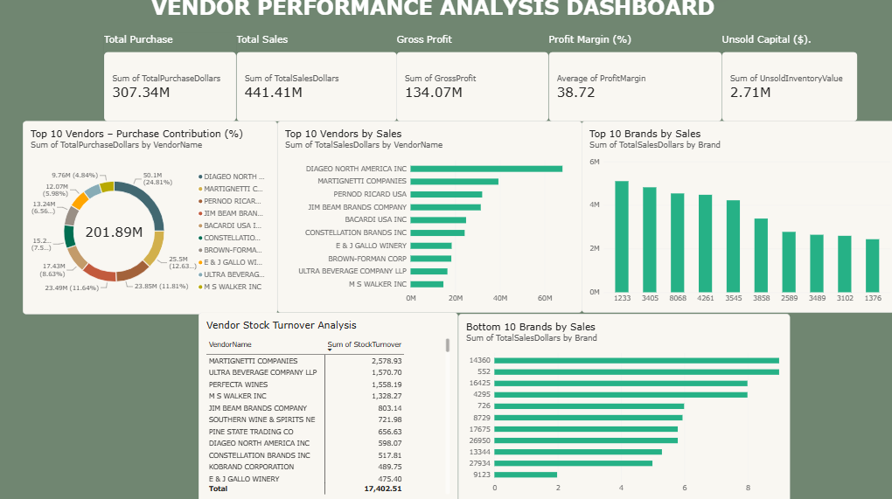

# Vendor Performance Analysis

An end-to-end data analytics project that evaluates vendor performance, purchasing patterns, brand sales, profitability, and inventory turnover using Python, SQL, and Power BI.

## 📊 Dashboard Preview



## 🎯 Project Overview

The objective of this project is to analyse vendor and brand performance using transactional and inventory data. The analysis helps identify top-performing vendors, understand purchasing contribution, compare brand sales, and investigate inventory turnover.

Python and SQL were used for data ingestion, preparation, and analysis, while Power BI was used to create an interactive dashboard.

## 🎯 Business Objectives

- Analyse total purchase, total sales, and gross profit.
- Identify the top 10 vendors by sales.
- Evaluate vendor purchase contribution.
- Identify the top 10 and bottom 10 brands by sales.
- Analyse vendor stock turnover.
- Monitor unsold inventory capital.
- Present key business insights through a Power BI dashboard.

## 🛠️ Technologies Used

| Technology | Purpose |
|---|---|
| Python | Data processing and analysis |
| Pandas | Data manipulation |
| SQL | Data storage and querying |
| SQLite | Database management |
| Jupyter Notebook | Exploratory data analysis |
| Power BI | Dashboard development |
| Matplotlib / Seaborn | Data visualisation |

## 📁 Project Structure

```text
Vendor_Performance_Analysis/
│
├── dashboard/
│   └── Vendor_Performance_Dashboard.pbix
│
├── data/
│   ├── begin_inventory.csv
│   ├── end_inventory.csv
│   ├── purchase_prices.csv
│   ├── purchases.csv
│   ├── sales.csv
│   └── vendor_invoice.csv
│
├── notebooks/
│   ├── Exploratory Data Analysis.ipynb
│   └── Vendor Performance Analysis.ipynb
│
├── report/
│   └── Vendor_Performance_Analysis_Report.pdf
│
├── screenshots/
│   └── Vendor_Performance_Dashboard.png
│
├── src/
│   ├── get_vendor_summary.py
│   └── ingestion_db.py
│
├── .gitignore
└── README.md
```

## 🔍 Methodology

1. **Data Ingestion:** Loaded source CSV files into an SQLite database using Python and SQLAlchemy.
2. **Data Preparation:** Combined relevant vendor, purchase, sales, and inventory information.
3. **Data Cleaning:** Prepared the analysis dataset and applied filters to retain relevant records.
4. **Feature Engineering:** Worked with measures such as Gross Profit, Profit Margin, Stock Turnover, and Sales-to-Purchase Ratio.
5. **Exploratory Data Analysis:** Analysed vendor contribution, brand sales, profitability, and inventory patterns.
6. **Dashboard Development:** Created KPI cards and interactive visualisations in Power BI.

## 📈 Key Dashboard Findings

| KPI | Value |
|---|---:|
| Total Purchase | 307.34M |
| Total Sales | 441.41M |
| Gross Profit | 134.07M |
| Average Profit Margin | 38.72 |
| Unsold Inventory Capital | 2.71M |
| Top 10 Vendors' Purchase Contribution | 201.89M |

The top 10 vendors contribute approximately 65.7% of total purchasing value.

## 📊 Dashboard Features

- KPI cards for overall business performance.
- Donut chart for vendor purchase contribution.
- Top 10 vendors by sales.
- Top 10 brands by sales.
- Bottom 10 brands by sales.
- Vendor stock turnover analysis.

## 📄 Project Report

The detailed six-page project report is available here:

[View Vendor Performance Analysis Report](report/Vendor_Performance_Analysis_Report.pdf)

## 🚀 How to Run

1. Clone this repository:

```bash
git clone https://github.com/YOUR-USERNAME/Vendor-Performance-Analysis.git
```

2. Navigate to the project directory:

```bash
cd Vendor-Performance-Analysis
```

3. Install the required Python libraries:

```bash
pip install pandas numpy sqlalchemy matplotlib seaborn jupyter
```

4. Run the data ingestion script:

```bash
python src/ingestion_db.py
```

5. Execute the analysis notebooks inside the `notebooks/` folder.

6. Open the Power BI file inside the `dashboard/` folder to explore the dashboard.

## 💡 Conclusion

This project demonstrates how data analytics tools can be used to transform raw business data into meaningful insights. By combining Python, SQL, and Power BI, the project provides a structured approach to understanding vendor performance, purchasing contribution, sales patterns, profitability, and inventory management.

---

**Author:** Swastika Gupta  
**B.Tech – Computer Science and Engineering**  
**KIIT University**
